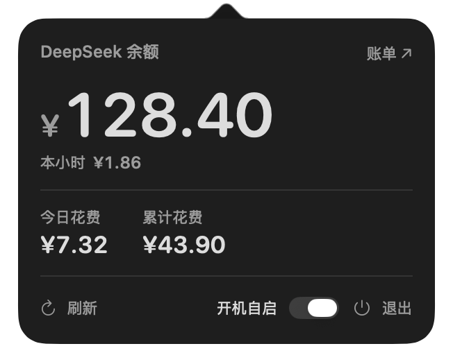

<p align="center">
  <a href="README.md">简体中文</a> &nbsp;·&nbsp; <b>English</b>
</p>

# DeepSeekSpend

<p align="center">
  
</p>

<p align="center">
  A tiny macOS menu bar widget that answers two questions: <b>how much is left</b>, and <b>how much am I burning this hour</b>.
</p>

<p align="center">
  <a href="LICENSE"></a>
  
  
</p>

> [!IMPORTANT]
> The spend figure is an estimate computed from local token logs and a price table — not a DeepSeek invoice. The balance comes from the official API.

## What it shows

| Dark | Light |
|---|---|
|  |  |

- Status bar always shows the remaining balance (`¥37.02`).
- Large number: balance. Small line: spend for the current clock hour.
- Below: today's spend and lifetime spend.
- Footer: refresh, launch at login, quit. No project tree, no per-session breakdown, no charts.

> Screenshots use demo numbers, captured with `--appearance` to force each theme.

## How the estimate works

```text
cost = uncached input tokens × input price
     + cache-hit input tokens × cache price
     + output tokens × output price
```

- Prices follow the [official pricing page](https://api-docs.deepseek.com/zh-cn/quick_start/pricing/), split into peak (weekdays 09:00–12:00 and 14:00–18:00 Beijing time) and idle (half price).
- Locally deployed models listed in `freeModels` are billed at ¥0 (e.g. `GLM-5.3-Flash`) and never raise a "missing price" warning.
- Branched / sub-agent sessions copy the parent's history into their own log, so calls are de-duplicated by a `time + model + tokens` fingerprint.
- Unknown models are priced at ¥0 with a visible note instead of silently borrowing another model's rate.

## Build from source

```bash
git clone <your-repo-url> DeepSeekSpend
cd DeepSeekSpend
npm test
./build.sh        # -> ../build/DeepSeekSpend.app
open ../build/DeepSeekSpend.app
```

Requires Apple silicon, macOS 13+, the Swift toolchain and a Node.js 22.15+ binary that supports zstd. The bundled runtime is looked up at `tools/node-runtime`, then `/Applications/DeepSeekSpend.app/Contents/Resources/node`, then `node` on `PATH`; override with `DEEPSEEKSPEND_NODE=/path/to/node`. Homebrew's `node` is a thin binary linked against `libnode.dylib` and is skipped automatically.

## Data & privacy

| Data | Source |
|---|---|
| Calls and tokens | `~/.dsh/sessions/**/session.v4.jsonl.zstd` |
| API key | `DEEPSEEK_API_KEY` in `~/.dsh/.credentials.yaml` |
| Balance | `https://api.deepseek.com/user/balance` |

Chat content is never read or uploaded — only token counts. The single network call is the balance lookup, sent to DeepSeek's official endpoint. No telemetry, no ads. The app is ad-hoc signed; building never touches certificates, the keychain, or trust settings.

## Configuration

`~/Library/Application Support/DeepSeekSpend/config.json`:

| Key | Meaning |
|---|---|
| `dshDataDir` | DSH data directory, defaults to `~/.dsh` |
| `prices.peakIdle` / `prices.flat` | CNY per million tokens |
| `freeModels` | Models to bill at ¥0 (wildcards like `glm-*` supported) |
| `pollIntervalMs` / `balanceIntervalMs` | Polling (8s) and balance refresh (5min) |
| `platformUrl` | Opened by the "账单 / Usage" link |

## Relation to upstream

A local fork of [yinshi1226-ai/DeepSeekSpend](https://github.com/yinshi1226-ai/DeepSeekSpend), keeping the upstream MIT license and copyright.

Changes: UI reduced to balance + spend; collector reads logs only (no local Harness API) and adds cross-session de-duplication plus free local models; pricing switched to official peak/idle tiers; build script adapted to the v4 log naming, the CLT `SwiftBridging` modulemap conflict and a self-contained Node runtime.

## License

[MIT](LICENSE) © upstream authors and contributors of this repository
