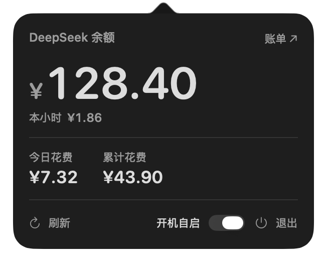
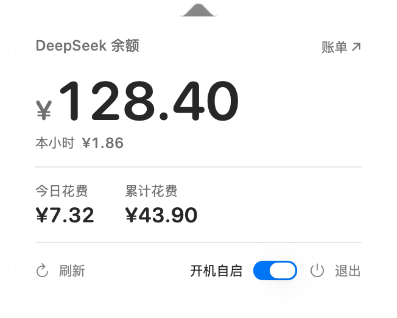

<p align="center">
  <b>简体中文</b> &nbsp;·&nbsp; <a href="README.en.md">English</a>
</p>

# DeepSeekSpend

<p align="center">
  
</p>

<p align="center">
  一个只回答两个问题的 macOS 菜单栏小组件：<b>我还剩多少钱</b>、<b>我这一小时花了多少</b>。
</p>

<p align="center">
  <a href="LICENSE"></a>
  
  
</p>

> [!IMPORTANT]
> 花费是按本地 token 记录和价目表算出来的**估算值**，不是 DeepSeek 官方账单。余额来自官方接口；最终扣费以官方平台为准。

## 界面

| 深色 | 浅色 |
|---|---|
|  |  |

- 状态栏常驻显示余额：`¥37.02`。
- 大字是剩余额度，小字是本自然小时的消费。
- 下面一行是今日花费与累计花费。
- 底部只有刷新、开机自启、退出。没有项目树、没有会话明细、没有柱状图。

> 截图中的余额与花费为演示数据，通过 `--appearance` 强制外观后截取。

## 它是怎么算的

```text
花费 = 未命中缓存的输入 token × 输入价
     + 命中缓存的输入 token × 缓存价
     + 输出 token × 输出价
```

- **按官方价目计费**：价目表取自 [DeepSeek 官方定价页](https://api-docs.deepseek.com/zh-cn/quick_start/pricing/)，并区分时段——北京时间工作日 09:00-12:00、14:00-18:00 为高峰，其余为空闲（半价）。
- **本地模型免费**：写进 `freeModels` 的模型按 ¥0 计，例如本地部署的 `GLM-5.3-Flash`，不会产生「缺价」告警。
- **跨会话去重**：DSH 的分支 / 子代理会话会把父会话历史整段复制进自己的日志，采集器按「时间 + 模型 + token」指纹去重，同一笔调用只算一次。
- 未配置单价的模型不会被悄悄套用别的价格，而是计 ¥0 并在面板上提示。

## 安装

目前没有预编译的 Release，从源码构建：

```bash
git clone <你的仓库地址> DeepSeekSpend
cd DeepSeekSpend
npm test          # 采集与计价单元测试
./build.sh        # 产物：../build/DeepSeekSpend.app
open ../build/DeepSeekSpend.app
```

要求：Apple silicon Mac、macOS 13+、Swift 工具链、Node.js 22.15+（支持 zstd）。

`build.sh` 需要一个**自包含**的 Node 可执行文件，默认依次找：

1. `tools/node-runtime`
2. `/Applications/DeepSeekSpend.app/Contents/Resources/node`
3. `$PATH` 里的 `node`

也可以用 `DEEPSEEKSPEND_NODE=/path/to/node ./build.sh` 指定。Homebrew 的 `node` 是动态链接 `libnode.dylib` 的精简版，直接塞进 App 会启动失败，脚本会自动跳过它。

## 数据与隐私

| 数据 | 来源 |
|---|---|
| 模型调用与 token | `~/.dsh/sessions/**/session.v4.jsonl.zstd`（兼容 `session.jsonl.zstd` / `session.jsonl`） |
| API Key | `~/.dsh/.credentials.yaml` 里的 `DEEPSEEK_API_KEY` |
| 账户余额 | `https://api.deepseek.com/user/balance` |

- 会话日志在本机解析，聊天内容不会被读取上传，只统计 token 数量。
- 唯一的网络请求是余额查询，Key 只发给 DeepSeek 官方接口。
- 没有遥测、没有广告 SDK、没有第三方服务器。
- 应用包用 ad-hoc 签名，构建过程不创建证书、不改钥匙串、不动系统信任设置。

## 配置

运行期配置在 `~/Library/Application Support/DeepSeekSpend/config.json`：

| 字段 | 说明 |
|---|---|
| `dshDataDir` | DSH 数据目录，默认 `~/.dsh` |
| `prices.peakIdle` / `prices.flat` | 价目表（元 / 百万 tokens） |
| `freeModels` | 免费模型名单，支持 `glm-*` 通配 |
| `pollIntervalMs` / `balanceIntervalMs` | 采集间隔（默认 8s）/ 余额刷新间隔（默认 5min） |
| `platformUrl` | 点「账单」时打开的地址 |

App 启动时会把包内 `config.json` 的 `prices`、`freeModels` 同步进用户配置，其余字段保留你的改动。

## 开发

```bash
npm test            # 8 个用例：峰谷时段、两档价目、免费模型、去重、事件解析
./build.sh          # 构建到 ../build/
open ../build/DeepSeekSpend.app
```

调试用：`--appearance light|dark` 强制外观，`--show-window` 把面板放进普通窗口（便于截图）。

## 与上游的关系

这是 [yinshi1226-ai/DeepSeekSpend](https://github.com/yinshi1226-ai/DeepSeekSpend) 的本地改版，保留上游的 MIT 许可与版权声明。

主要改动：

- 界面从「项目 / 任务 / 24 小时图表 / WorkBuddy」精简为「余额 + 花费」。
- 采集器不再调用本地 Harness API，只读会话日志；新增跨会话去重与本地免费模型支持。
- 计价改为官方高峰 / 空闲两档。
- 构建脚本适配新版 Harness 的日志命名、CLT 的 SwiftBridging modulemap 冲突、以及自包含 Node 运行时。

## License

[MIT](LICENSE) © 上游作者与本仓库贡献者
